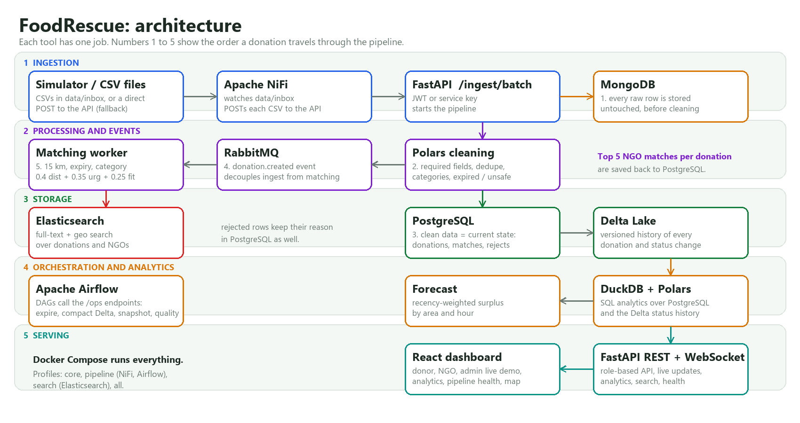

# Architecture

## The journey of one donation

1. **Ingestion.** A CSV lands in `data/inbox/` (simulator or upload) and **Apache NiFi** posts it to
   `POST /ingest/batch`. The same endpoint also accepts JSON, a CSV body, or a file upload, authenticated by a
   JWT (admin / donor) or the `X-API-Key` service key used by NiFi and Airflow. The simulator can also post
   directly, which is the fallback path that keeps the live demo running.
2. **Raw first (MongoDB).** Every incoming row is stored untouched in `raw_ingest`, before any cleaning, so the
   original input is never lost and rejected rows can be traced back.
3. **Cleaning (Polars).** `services/cleaning.py` validates required fields, parses numbers and dates, standardises
   categories, rejects expired or unsafe food, removes duplicates inside the batch and against the database, and
   fills missing coordinates from the area. Every rejection keeps a human-readable reason.
4. **Clean data (PostgreSQL).** Accepted rows become `donations` (and `requests` for NGO needs); rejected rows go to
   `rejected_rows`. PostgreSQL is the source of truth for the *current* state.
5. **History (Delta Lake).** After the commit, a `created` snapshot and every later status change
   (listed, matched, accepted, picked up, delivered, expired) are appended to Delta tables, giving a versioned
   history with time travel (`GET /history/donations/{id}?version=N`).
6. **Events (RabbitMQ).** One `donation.created` message per donation decouples ingestion from matching.
7. **Matching worker.** Filters NGO needs (15 km, category, enough shelf life to travel), scores them
   `0.4 x distance + 0.35 x urgency + 0.25 x quantity fit` and saves the top 5. A sweeper re-matches anything the
   queue missed (for example while the broker was down).
8. **Search (Elasticsearch).** Donations are indexed on creation and updated on every status change; the NGO and
   admin pages search them by text, category, area, size and distance.
9. **Orchestration (Airflow).** DAGs call the `/ops/*` endpoints: expire stale donations (10 min), analytics
   snapshot (15 min), Delta compaction (hourly), data-quality report (daily).
10. **Analytics (DuckDB + Polars).** SQL over Polars frames built from PostgreSQL and the Delta status history:
    summary, by area, by category, timeline, funnel, rejection reasons, top donors / NGOs, and a surplus forecast.
11. **Serving.** FastAPI exposes REST and a WebSocket; the React dashboard has donor, NGO and admin screens, an
    analytics page, a pipeline-health page and a live Leaflet map.

## Why each tool is used

| Tool | Job |
|---|---|
| Apache NiFi | Reliable, visible file ingestion: list, fetch, archive, POST, route failures |
| Python + Polars | Fast, testable column-wise cleaning |
| MongoDB | Schema-free vault for raw rows and event payloads |
| PostgreSQL | Transactions and relations for the current state; row locks prevent double accepts |
| RabbitMQ | Durable events so ingestion never waits for matching and nothing is lost on a crash |
| Delta Lake | Append-only, versioned history and time travel |
| Airflow | Scheduled maintenance, snapshots and data-quality checks |
| DuckDB + Polars | Fast analytical SQL for charts and the forecast |
| Elasticsearch | Instant text and geo search |
| FastAPI | Typed API, validation, OpenAPI docs, WebSocket |
| React + Leaflet | Role-based screens, live dashboard and map |
| Docker Compose | One command to start everything; profiles keep the base light |

## Reliability

* Mongo, Delta Lake and Elasticsearch writes are **best effort**: if one is down, ingestion and matching continue.
* If RabbitMQ is down at ingest time the data is still saved and the worker sweeper matches it later.
* The simulator's direct API call falls back to in-process ingestion so the demo never stops.
* NiFi routes failed files to `data/nifi-failed/` and moves processed files to `data/archive/`.
