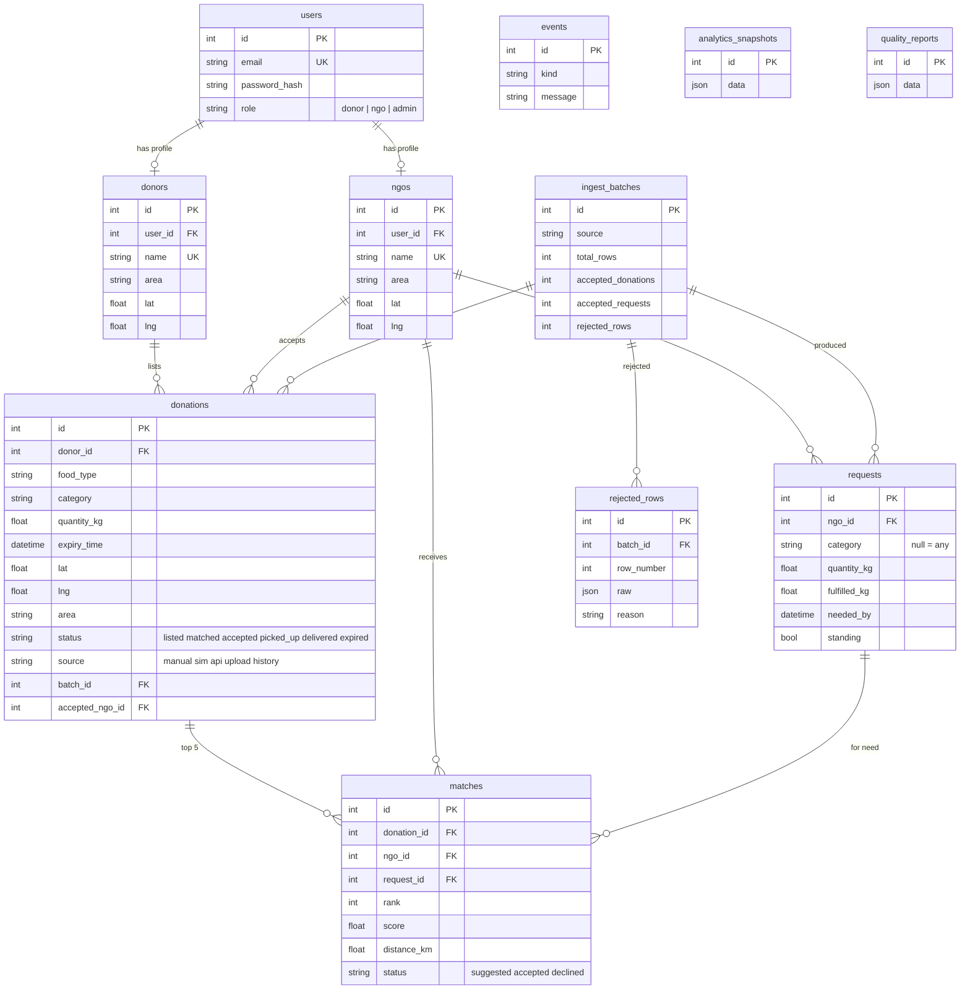

# Database model (PostgreSQL)

Other stores: **MongoDB** `raw_ingest` (every incoming row) and `events` (donation.created payloads);
**Delta Lake** tables `donation_history` and `status_events` under `data/delta/`;
**Elasticsearch** indices `fr-donations` and `fr-ngos`.
